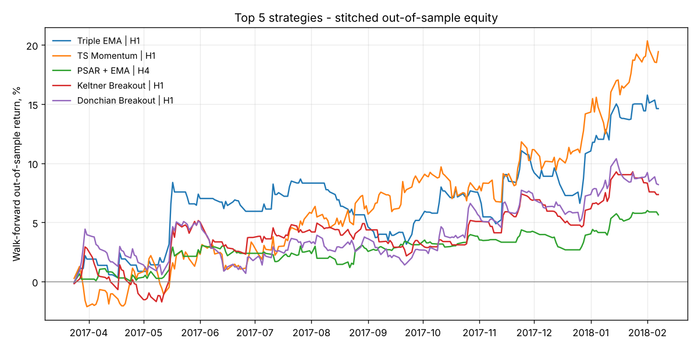

# Trend-following backtest report - `sample_eurusd_2017`

All numbers are **walk-forward out-of-sample**: parameters were picked using only data that came before each test period. Risk is 0.5% of equity per trade per pair, with costs included.

**Winner: Triple EMA on H1**, with OOS Sharpe 1.67, CAGR 16.9%, max drawdown -5.1% and profit factor 1.62 over 90 trades.
Parameters the walk-forward chose in each fold: `[{"fast": 20, "mid": 50, "slow": 200, "stop_mult": 2.0, "trail_mult": 3.0}, {"fast": 20, "mid": 50, "slow": 200, "stop_mult": 2.0, "trail_mult": 3.0}, {"fast": 10, "mid": 30, "slow": 100, "stop_mult": 2.0, "trail_mult": 3.0}, {"fast": 10, "mid": 30, "slow": 100, "stop_mult": 2.0, "trail_mult": 3.0}]`

## Strategy ranking (best timeframe for each)

|    | Strategy           | TF   |   Score |   Sharpe | CAGR   | Max DD   |   MAR |   PF | Win %   |   Trades | Param sets profitable   | Pairs profitable   |
|---:|:-------------------|:-----|--------:|---------:|:-------|:---------|------:|-----:|:--------|---------:|:------------------------|:-------------------|
|  1 | Triple EMA         | H1   |    0.93 |     1.67 | 16.9%  | -5.1%    |  3.32 | 1.62 | 35.6%   |       90 | 100.0%                  | 100.0%             |
|  2 | TS Momentum        | H1   |    0.91 |     1.94 | 22.5%  | -3.4%    |  6.68 | 2.28 | 35.7%   |      126 | 75.0%                   | 100.0%             |
|  3 | PSAR + EMA         | H4   |    0.88 |     1.46 | 6.5%   | -1.8%    |  3.57 | 2.01 | 46.7%   |       45 | 100.0%                  | 100.0%             |
|  4 | Keltner Breakout   | H1   |    0.71 |     1.08 | 8.4%   | -4.5%    |  1.87 | 1.28 | 32.5%   |      120 | 81.2%                   | 100.0%             |
|  5 | Donchian Breakout  | H1   |    0.67 |     1.18 | 9.4%   | -4.2%    |  2.24 | 1.26 | 35.0%   |      180 | 50.0%                   | 100.0%             |
|  6 | MACD + EMA Filter  | H1   |    0.67 |     0.96 | 7.4%   | -7.7%    |  0.96 | 1.22 | 36.9%   |      160 | 100.0%                  | 100.0%             |
|  7 | Bollinger Breakout | H1   |    0.59 |     0.91 | 8.3%   | -8.3%    |  0.99 | 1.15 | 34.7%   |      190 | 87.5%                   | 100.0%             |
|  8 | Ichimoku           | H1   |    0.38 |     0.08 | 0.4%   | -8.4%    |  0.04 | 1.03 | 27.8%   |      176 | 62.5%                   | 100.0%             |
|  9 | EMA Crossover      | H1   |    0.36 |    -0.37 | -2.9%  | -11.0%   | -0.26 | 0.88 | 24.4%   |      119 | 93.8%                   | 0.0%               |
| 10 | Supertrend         | H1   |    0.34 |     0.22 | 1.8%   | -6.4%    |  0.28 | 0.98 | 31.6%   |      155 | 33.3%                   | 100.0%             |
| 11 | ADX/DMI            | H4   |    0.31 |    -0.33 | -1.2%  | -4.4%    | -0.28 | 1.1  | 36.4%   |       33 | 62.5%                   | 0.0%               |
| 12 | KAMA Trend         | H4   |    0.1  |    -0.69 | -4.9%  | -6.5%    | -0.76 | 0.8  | 21.5%   |      163 | 6.2%                    | 0.0%               |

Rows with fewer than 30 OOS trades are ranked last because they are not statistically meaningful.

## Every strategy and timeframe

|    | Strategy           | TF   |   Score |   Sharpe | CAGR   | Max DD   |   MAR |   PF | Win %   |   Trades | Param sets profitable   | Pairs profitable   |
|---:|:-------------------|:-----|--------:|---------:|:-------|:---------|------:|-----:|:--------|---------:|:------------------------|:-------------------|
|  1 | Triple EMA         | H1   |    0.93 |     1.67 | 16.9%  | -5.1%    |  3.32 | 1.62 | 35.6%   |       90 | 100.0%                  | 100.0%             |
|  2 | TS Momentum        | H1   |    0.91 |     1.94 | 22.5%  | -3.4%    |  6.68 | 2.28 | 35.7%   |      126 | 75.0%                   | 100.0%             |
|  3 | PSAR + EMA         | H4   |    0.88 |     1.46 | 6.5%   | -1.8%    |  3.57 | 2.01 | 46.7%   |       45 | 100.0%                  | 100.0%             |
|  4 | TS Momentum        | H4   |    0.83 |     1.51 | 10.1%  | -5.9%    |  1.7  | 3.92 | 35.3%   |       34 | 100.0%                  | 100.0%             |
|  5 | Keltner Breakout   | H1   |    0.71 |     1.08 | 8.4%   | -4.5%    |  1.87 | 1.28 | 32.5%   |      120 | 81.2%                   | 100.0%             |
|  6 | Donchian Breakout  | H1   |    0.67 |     1.18 | 9.4%   | -4.2%    |  2.24 | 1.26 | 35.0%   |      180 | 50.0%                   | 100.0%             |
|  7 | MACD + EMA Filter  | H1   |    0.67 |     0.96 | 7.4%   | -7.7%    |  0.96 | 1.22 | 36.9%   |      160 | 100.0%                  | 100.0%             |
|  8 | Bollinger Breakout | H1   |    0.59 |     0.91 | 8.3%   | -8.3%    |  0.99 | 1.15 | 34.7%   |      190 | 87.5%                   | 100.0%             |
|  9 | Keltner Breakout   | H4   |    0.41 |     0.54 | 2.7%   | -4.9%    |  0.55 | 1.38 | 37.5%   |       32 | 37.5%                   | 100.0%             |
| 10 | Ichimoku           | H1   |    0.38 |     0.08 | 0.4%   | -8.4%    |  0.04 | 1.03 | 27.8%   |      176 | 62.5%                   | 100.0%             |
| 11 | MACD + EMA Filter  | H4   |    0.38 |     0.05 | 0.1%   | -3.6%    |  0.03 | 1.11 | 36.0%   |       50 | 75.0%                   | 100.0%             |
| 12 | PSAR + EMA         | H1   |    0.37 |     0.25 | 1.9%   | -7.5%    |  0.26 | 1.03 | 35.7%   |      207 | 37.5%                   | 100.0%             |
| 13 | EMA Crossover      | H1   |    0.36 |    -0.37 | -2.9%  | -11.0%   | -0.26 | 0.88 | 24.4%   |      119 | 93.8%                   | 0.0%               |
| 14 | Supertrend         | H1   |    0.34 |     0.22 | 1.8%   | -6.4%    |  0.28 | 0.98 | 31.6%   |      155 | 33.3%                   | 100.0%             |
| 15 | ADX/DMI            | H4   |    0.31 |    -0.33 | -1.2%  | -4.4%    | -0.28 | 1.1  | 36.4%   |       33 | 62.5%                   | 0.0%               |
| 16 | Supertrend         | H4   |    0.16 |    -0.4  | -2.7%  | -7.2%    | -0.38 | 0.7  | 31.1%   |       45 | 16.7%                   | 0.0%               |
| 17 | KAMA Trend         | H4   |    0.1  |    -0.69 | -4.9%  | -6.5%    | -0.76 | 0.8  | 21.5%   |      163 | 6.2%                    | 0.0%               |
| 18 | KAMA Trend         | H1   |    0.08 |    -0.8  | -12.9% | -17.0%   | -0.75 | 0.88 | 22.8%   |      602 | 0.0%                    | 0.0%               |
| 19 | ADX/DMI            | H1   |    0.07 |    -1.23 | -6.9%  | -7.3%    | -0.95 | 0.68 | 22.8%   |       92 | 31.2%                   | 0.0%               |
| 20 | EMA Crossover      | H4   |    0.83 |     1.63 | 12.0%  | -3.0%    |  4.03 | 6.27 | 46.7%   |       15 | 62.5%                   | 100.0%             |
| 21 | Donchian Breakout  | H4   |    0.7  |     1.22 | 5.1%   | -1.9%    |  2.69 | 3.08 | 61.1%   |       18 | 50.0%                   | 100.0%             |
| 22 | Triple EMA         | H4   |    0.62 |     0.73 | 3.2%   | -2.6%    |  1.24 | 1.44 | 36.8%   |       19 | 100.0%                  | 100.0%             |
| 23 | Bollinger Breakout | H4   |    0.62 |     1.02 | 4.4%   | -3.0%    |  1.48 | 2.53 | 61.1%   |       18 | 62.5%                   | 100.0%             |
| 24 | Ichimoku           | H4   |    0.57 |     0.96 | 3.7%   | -1.7%    |  2.14 | 2.18 | 55.0%   |       20 | 50.0%                   | 100.0%             |
