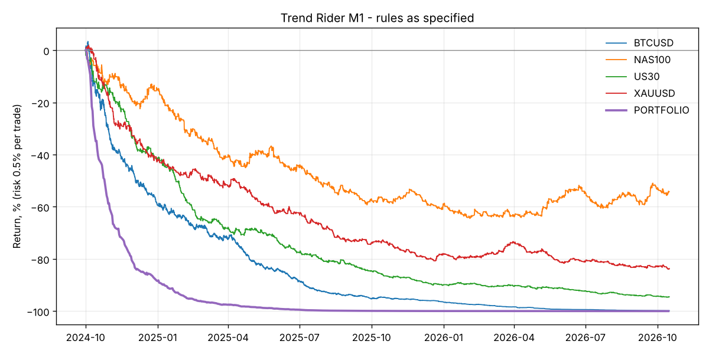

# Trend Rider (M1) - backtest

Risk 0.5% of equity per trade, all markets traded together. Costs: per-bar MT5 spread where available, otherwise the defaults in `backtester/data.py`.

## Rules as specified - full history

| symbol    |   trades |   trades_per_day | target_pct   | breakeven_pct   | stop_pct   |   avg_r |   profit_factor |   total_r | total_return   | max_dd   |   sharpe |
|:----------|---------:|-----------------:|:-------------|:----------------|:-----------|--------:|----------------:|----------:|:---------------|:---------|---------:|
| BTCUSD    |     4728 |             6.35 | 12.2%        | 24.2%           | 63.6%      |   -0.27 |            0.59 |  -1269.3  | -99.8%         | -99.8%   |    -7.28 |
| NAS100    |     2150 |             2.89 | 15.7%        | 29.0%           | 55.3%      |   -0.07 |            0.88 |   -145.41 | -53.6%         | -63.6%   |    -1.37 |
| US30      |     2308 |             3.1  | 12.0%        | 24.9%           | 63.2%      |   -0.25 |            0.61 |   -569.81 | -94.5%         | -94.6%   |    -5.71 |
| XAUUSD    |     2430 |             3.27 | 13.6%        | 28.5%           | 57.9%      |   -0.14 |            0.75 |   -351.81 | -83.7%         | -84.1%   |    -3.7  |
| PORTFOLIO |    11616 |            15.61 | 13.1%        | 26.1%           | 60.8%      |   -0.2  |            0.68 |  -2336.33 | -100.0%        | -100.0%  |    -9.19 |

## Rules as specified - hold-out (last 30% of each market)

| symbol   |   trades |   trades_per_day | target_pct   | breakeven_pct   | stop_pct   |   avg_r |   profit_factor |   total_r | total_return   | max_dd   |   sharpe |
|:---------|---------:|-----------------:|:-------------|:----------------|:-----------|--------:|----------------:|----------:|:---------------|:---------|---------:|
| BTCUSD   |     1287 |             5.75 | 10.1%        | 22.2%           | 67.7%      |   -0.4  |            0.45 |   -511.32 | -92.5%         | -92.5%   |    -7.41 |
| NAS100   |      641 |             2.91 | 18.6%        | 31.2%           | 50.2%      |    0.08 |            1.15 |     49.44 | 25.7%          | -16.8%   |     1.48 |
| US30     |      694 |             3.15 | 13.7%        | 26.5%           | 59.8%      |   -0.15 |            0.75 |   -105.74 | -42.1%         | -47.0%   |    -3.41 |
| XAUUSD   |      747 |             3.4  | 14.9%        | 30.1%           | 55.0%      |   -0.08 |            0.86 |    -57.62 | -26.0%         | -39.1%   |    -2.04 |

## Does each rule help? (portfolio, full history)

| variant                           |   trades |   trades_per_day | target_pct   | breakeven_pct   | stop_pct   |   avg_r |   profit_factor |   total_r | total_return   | max_dd   |   sharpe |
|:----------------------------------|---------:|-----------------:|:-------------|:----------------|:-----------|--------:|----------------:|----------:|:---------------|:---------|---------:|
| As specified (1:3, BE at 1R)      |    11616 |            15.61 | 13.1%        | 26.1%           | 60.8%      |   -0.2  |            0.68 |  -2336.33 | -100.0%        | -100.0%  |    -9.19 |
| No break-even                     |    11016 |            14.81 | 20.3%        | 0.0%            | 79.7%      |   -0.2  |            0.76 |  -2148.12 | -100.0%        | -100.0%  |    -7.38 |
| BE at 1.5R                        |    11377 |            15.29 | 15.8%        | 16.0%           | 68.2%      |   -0.2  |            0.71 |  -2295.26 | -100.0%        | -100.0%  |    -8.58 |
| 1:2 R:R, BE at 1R                 |    11867 |            15.95 | 19.5%        | 19.6%           | 60.9%      |   -0.21 |            0.67 |  -2470.32 | -100.0%        | -100.0%  |   -10.8  |
| No consolidation filter           |    72394 |            97.3  | 12.9%        | 27.1%           | 60.0%      |   -0.19 |            0.68 | -14032.6  | -100.0%        | -100.0%  |   -18.47 |
| Stricter filter (ADX>30, CHOP<45) |     3162 |             4.25 | 13.4%        | 23.7%           | 62.8%      |   -0.22 |            0.66 |   -696.15 | -97.2%         | -97.3%   |    -5.57 |
| US session only (13-20 UTC)       |     3025 |             4.07 | 12.8%        | 28.6%           | 58.6%      |   -0.18 |            0.69 |   -556.69 | -94.3%         | -94.8%   |    -4.89 |

## Monthly portfolio returns

| time                | return   |
|:--------------------|:---------|
| 2024-10-31 00:00:00 | -58.6%   |
| 2024-11-30 00:00:00 | -52.9%   |
| 2024-12-31 00:00:00 | -40.2%   |
| 2025-01-31 00:00:00 | -46.9%   |
| 2025-02-28 00:00:00 | -40.6%   |
| 2025-03-31 00:00:00 | -32.4%   |
| 2025-04-30 00:00:00 | -35.2%   |
| 2025-05-31 00:00:00 | -41.2%   |
| 2025-06-30 00:00:00 | -44.7%   |
| 2025-07-31 00:00:00 | -57.3%   |
| 2025-08-31 00:00:00 | -39.8%   |
| 2025-09-30 00:00:00 | -41.8%   |
| 2025-10-31 00:00:00 | -16.3%   |
| 2025-11-30 00:00:00 | -30.1%   |
| 2025-12-31 00:00:00 | -33.4%   |
| 2026-01-31 00:00:00 | -35.0%   |
| 2026-02-28 00:00:00 | -20.4%   |
| 2026-03-31 00:00:00 | -10.1%   |
| 2026-04-30 00:00:00 | -42.8%   |
| 2026-05-31 00:00:00 | -41.5%   |
| 2026-06-30 00:00:00 | -22.3%   |
| 2026-07-31 00:00:00 | -43.9%   |
| 2026-08-31 00:00:00 | -40.0%   |
| 2026-09-30 00:00:00 | -34.4%   |
| 2026-10-31 00:00:00 | -27.8%   |

