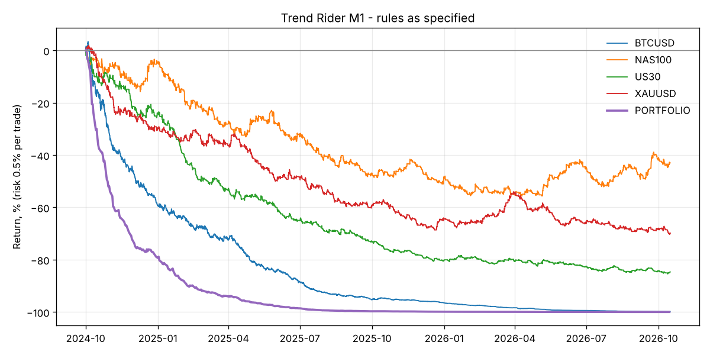

# Trend Rider (M1) - backtest

Risk 0.5% of equity per trade, all markets traded together. Costs: per-bar MT5 spread where available, otherwise the defaults in `backtester/data.py`.

## Rules as specified - full history

| symbol    |   trades |   trades_per_day | target_pct   | breakeven_pct   | stop_pct   |   avg_r |   profit_factor |   total_r | total_return   | max_dd   |   sharpe |
|:----------|---------:|-----------------:|:-------------|:----------------|:-----------|--------:|----------------:|----------:|:---------------|:---------|---------:|
| BTCUSD    |     4728 |             6.35 | 12.2%        | 24.2%           | 63.6%      |   -0.27 |            0.59 |  -1269.3  | -99.8%         | -99.8%   |    -7.28 |
| NAS100    |     2146 |             2.88 | 15.8%        | 30.2%           | 54.0%      |   -0.05 |            0.91 |   -101.48 | -42.1%         | -55.0%   |    -0.94 |
| US30      |     2280 |             3.06 | 13.5%        | 27.1%           | 59.4%      |   -0.16 |            0.73 |   -363.93 | -84.5%         | -85.2%   |    -3.69 |
| XAUUSD    |     2414 |             3.24 | 14.5%        | 29.8%           | 55.7%      |   -0.09 |            0.83 |   -228.65 | -69.9%         | -70.6%   |    -2.45 |
| PORTFOLIO |    11568 |            15.55 | 13.6%        | 27.0%           | 59.3%      |   -0.17 |            0.72 |  -1963.36 | -100.0%        | -100.0%  |    -7.8  |

## Rules as specified - hold-out (last 30% of each market)

| symbol   |   trades |   trades_per_day | target_pct   | breakeven_pct   | stop_pct   |   avg_r |   profit_factor |   total_r | total_return   | max_dd   |   sharpe |
|:---------|---------:|-----------------:|:-------------|:----------------|:-----------|--------:|----------------:|----------:|:---------------|:---------|---------:|
| BTCUSD   |     1287 |             5.75 | 10.1%        | 22.2%           | 67.7%      |   -0.4  |            0.45 |   -511.32 | -92.5%         | -92.5%   |    -7.41 |
| NAS100   |      643 |             2.92 | 18.2%        | 32.3%           | 49.5%      |    0.08 |            1.15 |     48.4  | 25.1%          | -16.4%   |     1.46 |
| US30     |      692 |             3.15 | 15.9%        | 27.2%           | 56.9%      |   -0.05 |            0.91 |    -37.36 | -18.7%         | -28.4%   |    -1.17 |
| XAUUSD   |      744 |             3.38 | 15.3%        | 30.8%           | 53.9%      |   -0.05 |            0.91 |    -37.55 | -18.2%         | -34.7%   |    -1.32 |

## Does each rule help? (portfolio, full history)

| variant                           |   trades |   trades_per_day | target_pct   | breakeven_pct   | stop_pct   |   avg_r |   profit_factor |   total_r | total_return   | max_dd   |   sharpe |
|:----------------------------------|---------:|-----------------:|:-------------|:----------------|:-----------|--------:|----------------:|----------:|:---------------|:---------|---------:|
| As specified (1:3, BE at 1R)      |    11568 |            15.55 | 13.6%        | 27.0%           | 59.3%      |   -0.17 |            0.72 |  -1963.36 | -100.0%        | -100.0%  |    -7.8  |
| No break-even                     |    10973 |            14.75 | 21.2%        | 0.0%            | 78.8%      |   -0.16 |            0.8  |  -1769.41 | -100.0%        | -100.0%  |    -6.08 |
| BE at 1.5R                        |    11330 |            15.23 | 16.5%        | 16.5%           | 67.0%      |   -0.17 |            0.76 |  -1889.92 | -100.0%        | -100.0%  |    -7.06 |
| 1:2 R:R, BE at 1R                 |    11829 |            15.9  | 20.2%        | 20.4%           | 59.4%      |   -0.18 |            0.7  |  -2120.86 | -100.0%        | -100.0%  |    -9.34 |
| No consolidation filter           |    71146 |            95.63 | 13.5%        | 28.3%           | 58.3%      |   -0.16 |            0.73 | -11232.1  | -100.0%        | -100.0%  |   -15.39 |
| Stricter filter (ADX>30, CHOP<45) |     3156 |             4.24 | 13.8%        | 24.8%           | 61.4%      |   -0.19 |            0.69 |   -613.33 | -95.8%         | -95.8%   |    -4.94 |
| US session only (13-20 UTC)       |     3021 |             4.06 | 13.0%        | 29.1%           | 57.9%      |   -0.17 |            0.71 |   -512.61 | -92.9%         | -93.5%   |    -4.5  |

## Monthly portfolio returns

| time                | return   |
|:--------------------|:---------|
| 2024-10-31 00:00:00 | -51.9%   |
| 2024-11-30 00:00:00 | -42.1%   |
| 2024-12-31 00:00:00 | -25.0%   |
| 2025-01-31 00:00:00 | -41.4%   |
| 2025-02-28 00:00:00 | -34.0%   |
| 2025-03-31 00:00:00 | -25.5%   |
| 2025-04-30 00:00:00 | -37.2%   |
| 2025-05-31 00:00:00 | -40.9%   |
| 2025-06-30 00:00:00 | -37.7%   |
| 2025-07-31 00:00:00 | -53.5%   |
| 2025-08-31 00:00:00 | -33.2%   |
| 2025-09-30 00:00:00 | -37.5%   |
| 2025-10-31 00:00:00 | -13.3%   |
| 2025-11-30 00:00:00 | -25.5%   |
| 2025-12-31 00:00:00 | -27.8%   |
| 2026-01-31 00:00:00 | -33.7%   |
| 2026-02-28 00:00:00 | -19.1%   |
| 2026-03-31 00:00:00 | -6.5%    |
| 2026-04-30 00:00:00 | -42.1%   |
| 2026-05-31 00:00:00 | -37.9%   |
| 2026-06-30 00:00:00 | -18.2%   |
| 2026-07-31 00:00:00 | -39.9%   |
| 2026-08-31 00:00:00 | -32.2%   |
| 2026-09-30 00:00:00 | -30.1%   |
| 2026-10-31 00:00:00 | -25.7%   |

