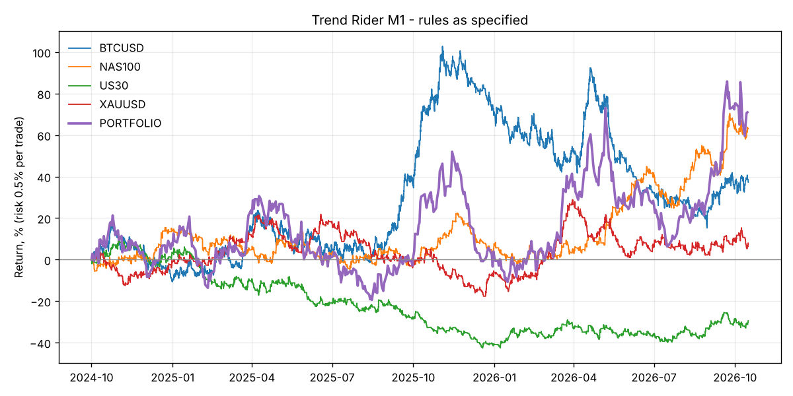

# Trend Rider (M1) - backtest

Risk 0.5% of equity per trade, all markets traded together. Costs: per-bar MT5 spread where available, otherwise the defaults in `backtester/data.py`.

## Rules as specified - full history

| symbol    |   trades |   trades_per_day | target_pct   | breakeven_pct   | stop_pct   |   avg_r |   profit_factor |   total_r | total_return   | max_dd   |   sharpe |
|:----------|---------:|-----------------:|:-------------|:----------------|:-----------|--------:|----------------:|----------:|:---------------|:---------|---------:|
| BTCUSD    |     4517 |             6.07 | 17.0%        | 31.9%           | 51.1%      |    0.02 |            1.04 |     87.21 | 37.1%          | -39.9%   |     0.63 |
| NAS100    |     2128 |             2.86 | 17.4%        | 33.3%           | 49.2%      |    0.05 |            1.1  |    109.16 | 65.5%          | -20.3%   |     1.11 |
| US30      |     2262 |             3.04 | 15.6%        | 32.1%           | 52.3%      |   -0.03 |            0.95 |    -58.61 | -28.8%         | -47.2%   |    -0.59 |
| XAUUSD    |     2385 |             3.21 | 16.3%        | 32.9%           | 50.9%      |    0.01 |            1.02 |     26.48 | 7.5%           | -32.2%   |     0.27 |
| PORTFOLIO |    11292 |            15.18 | 16.6%        | 32.4%           | 50.9%      |    0.01 |            1.03 |    164.24 | 71.0%          | -41.3%   |     0.75 |

## Rules as specified - hold-out (last 30% of each market)

| symbol   |   trades |   trades_per_day | target_pct   | breakeven_pct   | stop_pct   |   avg_r |   profit_factor |   total_r | total_return   | max_dd   |   sharpe |
|:---------|---------:|-----------------:|:-------------|:----------------|:-----------|--------:|----------------:|----------:|:---------------|:---------|---------:|
| BTCUSD   |     1187 |             5.3  | 16.0%        | 32.8%           | 51.2%      |   -0.02 |            0.97 |    -21.41 | -13.0%         | -37.5%   |    -0.56 |
| NAS100   |      638 |             2.9  | 19.7%        | 33.9%           | 46.4%      |    0.15 |            1.33 |     98.85 | 60.9%          | -12.4%   |     2.95 |
| US30     |      687 |             3.12 | 17.3%        | 30.7%           | 52.0%      |    0.03 |            1.06 |     22.31 | 9.6%           | -14.2%   |     0.71 |
| XAUUSD   |      737 |             3.35 | 16.6%        | 32.7%           | 50.7%      |    0.02 |            1.04 |     14.15 | 5.9%           | -21.3%   |     0.51 |

## Does each rule help? (portfolio, full history)

| variant                           |   trades |   trades_per_day | target_pct   | breakeven_pct   | stop_pct   |   avg_r |   profit_factor |   total_r | total_return   | max_dd   |   sharpe |
|:----------------------------------|---------:|-----------------:|:-------------|:----------------|:-----------|--------:|----------------:|----------:|:---------------|:---------|---------:|
| As specified (1:3, BE at 1R)      |    11292 |            15.18 | 16.6%        | 32.4%           | 50.9%      |    0.01 |            1.03 |    164.24 | 71.0%          | -41.3%   |     0.75 |
| No break-even                     |    10666 |            14.34 | 25.6%        | 0.0%            | 74.4%      |    0.02 |            1.03 |    241.55 | 123.7%         | -39.8%   |     0.92 |
| BE at 1.5R                        |    11044 |            14.84 | 19.9%        | 20.2%           | 59.9%      |    0.02 |            1.03 |    168.86 | 69.4%          | -39.4%   |     0.73 |
| 1:2 R:R, BE at 1R                 |    11585 |            15.57 | 24.4%        | 24.7%           | 51.0%      |   -0    |            1    |    -26.86 | -28.2%         | -57.6%   |    -0.1  |
| No consolidation filter           |    66408 |            89.26 | 16.2%        | 33.5%           | 50.2%      |    0.01 |            1.02 |    746.81 | 394.7%         | -98.9%   |     1.27 |
| Stricter filter (ADX>30, CHOP<45) |     3088 |             4.15 | 17.5%        | 30.9%           | 51.6%      |    0.03 |            1.06 |     95.7  | 44.8%          | -41.2%   |     0.78 |
| US session only (13-20 UTC)       |     2963 |             3.98 | 14.8%        | 32.9%           | 52.2%      |   -0.05 |            0.9  |   -152.3  | -57.2%         | -66.6%   |    -1.33 |

## Monthly portfolio returns

| time                | return   |
|:--------------------|:---------|
| 2024-10-31 00:00:00 | 14.1%    |
| 2024-11-30 00:00:00 | -11.0%   |
| 2024-12-31 00:00:00 | 6.3%     |
| 2025-01-31 00:00:00 | -8.4%    |
| 2025-02-28 00:00:00 | 6.9%     |
| 2025-03-31 00:00:00 | 17.1%    |
| 2025-04-30 00:00:00 | 1.1%     |
| 2025-05-31 00:00:00 | -19.9%   |
| 2025-06-30 00:00:00 | 0.9%     |
| 2025-07-31 00:00:00 | -8.9%    |
| 2025-08-31 00:00:00 | -3.7%    |
| 2025-09-30 00:00:00 | 9.5%     |
| 2025-10-31 00:00:00 | 46.7%    |
| 2025-11-30 00:00:00 | -6.9%    |
| 2025-12-31 00:00:00 | -21.7%   |
| 2026-01-31 00:00:00 | -5.6%    |
| 2026-02-28 00:00:00 | 1.6%     |
| 2026-03-31 00:00:00 | 35.9%    |
| 2026-04-30 00:00:00 | 6.8%     |
| 2026-05-31 00:00:00 | -12.5%   |
| 2026-06-30 00:00:00 | 1.5%     |
| 2026-07-31 00:00:00 | -5.8%    |
| 2026-08-31 00:00:00 | 8.3%     |
| 2026-09-30 00:00:00 | 31.6%    |
| 2026-10-31 00:00:00 | -0.8%    |

