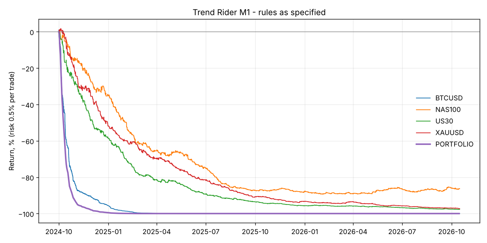

# Trend Rider (M1) - backtest

Risk 0.5% of equity per trade, all markets traded together. Costs: per-bar MT5 spread where available, otherwise the defaults in `backtester/data.py`.

## Rules as specified - full history

| symbol    |   trades |   trades_per_day | target_pct   | breakeven_pct   | stop_pct   |   avg_r |   profit_factor |   total_r | total_return   | max_dd   |   sharpe |
|:----------|---------:|-----------------:|:-------------|:----------------|:-----------|--------:|----------------:|----------:|:---------------|:---------|---------:|
| BTCUSD    |     5318 |             7.15 | 6.0%         | 11.2%           | 82.8%      |   -0.9  |            0.17 |  -4783.02 | -100.0%        | -100.0%  |   -10.03 |
| NAS100    |     2181 |             2.93 | 13.7%        | 26.6%           | 59.7%      |   -0.18 |            0.71 |   -387.15 | -86.1%         | -89.2%   |    -3.58 |
| US30      |     2349 |             3.16 | 11.2%        | 23.0%           | 65.8%      |   -0.32 |            0.54 |   -740.85 | -97.7%         | -97.7%   |    -7.14 |
| XAUUSD    |     2471 |             3.32 | 11.4%        | 24.6%           | 64.1%      |   -0.29 |            0.56 |   -708.06 | -97.3%         | -97.3%   |    -7.29 |
| PORTFOLIO |    12319 |            16.56 | 9.4%         | 18.9%           | 71.7%      |   -0.54 |            0.36 |  -6619.08 | -100.0%        | -100.0%  |   -12.6  |

## Rules as specified - hold-out (last 30% of each market)

| symbol   |   trades |   trades_per_day | target_pct   | breakeven_pct   | stop_pct   |   avg_r |   profit_factor |   total_r | total_return   | max_dd   |   sharpe |
|:---------|---------:|-----------------:|:-------------|:----------------|:-----------|--------:|----------------:|----------:|:---------------|:---------|---------:|
| BTCUSD   |     1442 |             6.44 | 4.9%         | 9.4%            | 85.6%      |   -0.97 |            0.14 |  -1404.4  | -99.9%         | -99.9%   |    -8.36 |
| NAS100   |      641 |             2.91 | 18.6%        | 31.2%           | 50.2%      |    0.08 |            1.15 |     49.36 | 25.7%          | -16.8%   |     1.48 |
| US30     |      694 |             3.15 | 13.7%        | 26.5%           | 59.8%      |   -0.15 |            0.75 |   -105.96 | -42.2%         | -47.1%   |    -3.42 |
| XAUUSD   |      751 |             3.41 | 13.6%        | 26.2%           | 60.2%      |   -0.18 |            0.7  |   -138.2  | -50.5%         | -58.2%   |    -4.49 |

## Does each rule help? (portfolio, full history)

| variant                           |   trades |   trades_per_day | target_pct   | breakeven_pct   | stop_pct   |   avg_r |   profit_factor |   total_r | total_return   | max_dd   |   sharpe |
|:----------------------------------|---------:|-----------------:|:-------------|:----------------|:-----------|--------:|----------------:|----------:|:---------------|:---------|---------:|
| As specified (1:3, BE at 1R)      |    12319 |            16.56 | 9.4%         | 18.9%           | 71.7%      |   -0.54 |            0.36 |  -6619.08 | -100.0%        | -100.0%  |   -12.6  |
| No break-even                     |    11805 |            15.87 | 14.7%        | 0.0%            | 85.3%      |   -0.53 |            0.45 |  -6309.86 | -100.0%        | -100.0%  |   -11.75 |
| BE at 1.5R                        |    12138 |            16.31 | 11.2%        | 12.0%           | 76.8%      |   -0.54 |            0.39 |  -6580.37 | -100.0%        | -100.0%  |   -12.43 |
| 1:2 R:R, BE at 1R                 |    12557 |            16.88 | 14.2%        | 14.2%           | 71.6%      |   -0.54 |            0.36 |  -6750.83 | -100.0%        | -100.0%  |   -13.21 |
| No consolidation filter           |    84858 |           114.06 | 9.1%         | 19.2%           | 71.7%      |   -0.52 |            0.36 | -44518.5  | -100.0%        | -100.0%  |   -22.9  |
| Stricter filter (ADX>30, CHOP<45) |     3344 |             4.49 | 9.3%         | 16.3%           | 74.4%      |   -0.63 |            0.32 |  -2097.31 | -100.0%        | -100.0%  |    -8.26 |
| US session only (13-20 UTC)       |     3132 |             4.21 | 10.7%        | 22.6%           | 66.7%      |   -0.41 |            0.46 |  -1284.25 | -99.8%         | -99.9%   |    -7.96 |

## Monthly portfolio returns

| time                | return   |
|:--------------------|:---------|
| 2024-10-31 00:00:00 | -92.7%   |
| 2024-11-30 00:00:00 | -70.9%   |
| 2024-12-31 00:00:00 | -75.6%   |
| 2025-01-31 00:00:00 | -85.5%   |
| 2025-02-28 00:00:00 | -89.3%   |
| 2025-03-31 00:00:00 | -82.1%   |
| 2025-04-30 00:00:00 | -82.3%   |
| 2025-05-31 00:00:00 | -86.9%   |
| 2025-06-30 00:00:00 | -87.7%   |
| 2025-07-31 00:00:00 | -87.9%   |
| 2025-08-31 00:00:00 | -73.6%   |
| 2025-09-30 00:00:00 | -79.9%   |
| 2025-10-31 00:00:00 | -49.2%   |
| 2025-11-30 00:00:00 | -43.2%   |
| 2025-12-31 00:00:00 | -43.2%   |
| 2026-01-31 00:00:00 | -67.9%   |
| 2026-02-28 00:00:00 | -50.8%   |
| 2026-03-31 00:00:00 | -42.5%   |
| 2026-04-30 00:00:00 | -81.7%   |
| 2026-05-31 00:00:00 | -68.1%   |
| 2026-06-30 00:00:00 | -35.5%   |
| 2026-07-31 00:00:00 | -75.5%   |
| 2026-08-31 00:00:00 | -67.0%   |
| 2026-09-30 00:00:00 | -68.0%   |
| 2026-10-31 00:00:00 | -57.3%   |

